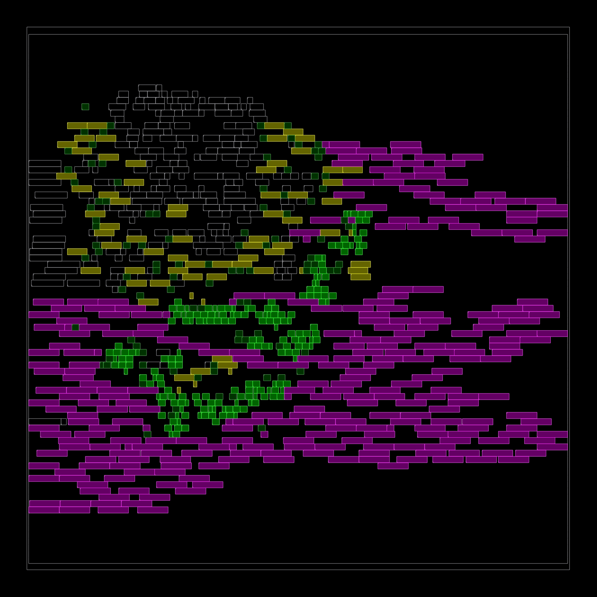

# Place and route with OpenROAD

chisel-async exports a timing contract with every design. This guide takes the
quickstart designs from Chisel to routed layouts on GF180MCU and ASAP7 with
OpenROAD, and checks that contract on the routed netlists with extracted
parasitics, using the library's own `TimingConstraints` and `OpenSta.check`.



*The quickstart `Gcd` placed on GF180MCU 7-track: C-elements green, latches
yellow, matched delay lines magenta, other control gates dark green, datapath
logic outlined.*

The quickstart designs are small, fast-turnaround tests of the flow, not
designs meant for tape-out. The numbers below show that the build produces
measurements end to end: a routed layout, a contract check and a timed
simulation per corner, every one reproducible with one command.

## Run it

Bazelisk is the only install. Every other tool, the PDKs and a pinned Chisel
toolchain are fetched and built by Bazel. Linux x86-64; the library itself
keeps its sbt build and platforms.

```text
bazelisk test //examples/quickstart:all          # contract checks, GF180MCU and ASAP7, fast and slow corners
bazelisk build //examples/comparison:all         # timed simulations and idle power, async and clocked
bazelisk run //examples/quickstart:addpipeline_gf180_route gui_route   # open a routed layout in the OpenROAD GUI
```

The first run builds OpenROAD and Yosys from source and takes a while; later
runs only redo what changed.

## What the flow does

| Step | What runs | Where |
| --- | --- | --- |
| Export | `AsicMapping.prepare` and `plan.emit` with standard-cell adapters for every required primitive | `openroad/Export.scala`, `openroad/Adapters.scala` |
| Synthesis to routing | OpenROAD-flow-scripts through bazel-orfs; every primitive cell and its internal nets `dont_touch` | `openroad/async_flow.bzl` |
| Contract check | Every contract endpoint bound to a routed pin or port, then `TimingConstraints.emit` and `OpenSta.check`, unchanged, with the routed SPEF, one corner per run | `openroad/Signoff.scala` |
| Timed simulation | The routed netlist with each cell output's STA delay, simulated in Icarus 13 against a reference model | `openroad/Timed.scala`, `examples/comparison/bench` |

Each design takes its timing policy, `BundledTiming.simulation(cellMin,
cellMax, dataMax)`, from the PDK: the bounds come from what the check measured
at the slow corner. The quickstart classes gained a `timing` parameter for
this; their defaults are unchanged.

## Contract check

`AddPipeline` passes its whole contract, 32 paths and 2 orderings, on
GF180MCU and ASAP7 at both the fast and the slow corner:

| PDK | Corners | Result |
| --- | --- | --- |
| GF180MCU 7-track, 5 V | FF n40C 5.5 V, SS 125C 4.5 V | `CHECKED_DECLARED_PATHS` |
| ASAP7 | FF, SS | `CHECKED_DECLARED_PATHS` |

On the way there the check caught what it is for: a matched delay line short
of its bound at the GF180MCU fast corner (4.02 ns against 4.05 ns), and a cell
over its bound at the slow corners. Both were fixed in the adapters and the
policy, not by relaxing the check.

`Gcd` places and routes on both PDKs and simulates correctly, but its
contract check is left as a manual target; see the questions below.

## Timed simulation and idle power

Both quickstart algorithms were also written as ordinary clocked Chisel
(`examples/comparison`) and taken through the same flow. Each routed design is
simulated on the same workload with every result checked: 64 additions, and
24 GCD jobs taking 821 subtractions. The clocked design runs at the period STA
says it reaches at that corner.

| Design, PDK | Corner | Asynchronous | Clocked |
| --- | --- | --- | --- |
| AddPipeline, GF180MCU | FF | 68.8 ns per token | 3.15 ns per token |
| | SS | 226 ns | 10.4 ns |
| Gcd, GF180MCU | FF | 198 µs for the jobs | 3.46 µs |
| | SS | 659 µs | 10.5 µs |
| AddPipeline, ASAP7 | FF | 3.34 ns per token | 0.159 ns per token |
| Gcd, ASAP7 | FF | 9.26 µs | 0.250 µs |

While waiting, with no input moving, the asynchronous designs draw only
leakage; the clocked ones keep their clock running:

| Design, PDK, FF | Asynchronous | Clocked |
| --- | --- | --- |
| AddPipeline, GF180MCU | 0.045 µW | 2,350 µW at 8 ns |
| Gcd, GF180MCU | 0.19 µW | 3,020 µW at 8 ns |
| AddPipeline, ASAP7 | 0.014 µW | 138 µW at 300 ps |

Where the asynchronous time goes in these runs: four-phase return-to-zero
takes every matched delay line twice per token; the bounds are absolute, so a
delay line must cover the slow corner's data path while being fast-corner
cells; and the `simulation()` policy's output guard is three cell maxima. The
adapters size delay lines from a conservative per-stage estimate. Each of
these is a knob, not a property of asynchronous logic.

## How the routed netlist is checked

- **Bindings.** A primitive's port binds to the adapter cell pin that
  implements it; for an arc check, the C-element state gate's own pin. A
  channel endpoint binds through the compiler's `ref_<top>.sv` probe ABI to
  the adapter pin that drives it (a path start) or that it feeds (a path end);
  a start driven by synthesized logic moves to the net's one adapter load,
  and an end loaded only by synthesized logic moves to the net's driver, so
  only a wire is ever left out.
- **Loops.** OpenSTA breaks every combinational loop at an arc of its own
  choosing and computes no delay for it; on these controllers it picks
  C-element set arcs, which the contract measures. The flow cuts the loops
  itself, in an analysis copy of the routed netlist: each C-element's own
  feedback, then C-element input-decode pins until no loop is left, never on
  the direct route of a measured path. The cuts are listed in
  `arc-cuts.txt` next to each result.
- **Adapters.** A C-element is reset-gated set and hold decode feeding one
  state gate with feedback (`AO21` on ASAP7, `aoi21` and an inverter on
  GF180MCU); a latch is `DLLx1` or `latrnq`; a matched delay is a chain of
  `HB4xp67` or `dlyd` cells. These are trial adapters built from library
  gates, recorded as `mapped-unqualified`.

## Questions for the library

1. Is a C-element built from library gates acceptable for these checks, with
   arcs read across its state gate, or should the flow wait for characterized
   cells?
2. The flow cuts handshake loops for STA as described above. Is that the cut
   you intend `corner.tcl` to carry, or would you place them elsewhere?
3. `Gcd`'s contract times the initial-token selector state to the token's data
   output. With a constant initial value, synthesis removes that path, and
   `OpenSta.check` rightly refuses a bit with no path. Should such a path stay
   in the contract?
4. Would relative bounds (a delay line against the data path it matches, at
   the same corner) or an asymmetric delay element fit the library? Either
   would take back much of the time above.

## Carried patches

`bazel/patches` carries what the flow needs from other projects until they
have it, each with its reason and how it retires; each keeps the license of
the project it patches. See [bazel/patches](../bazel/patches/README.md).
